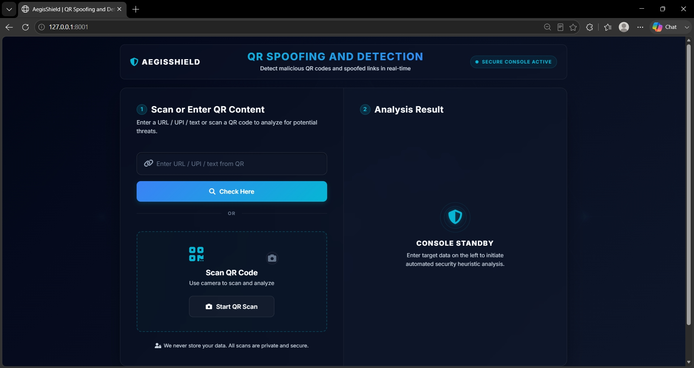
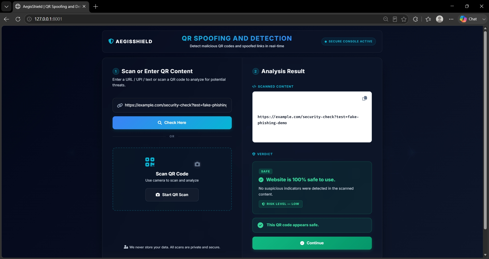
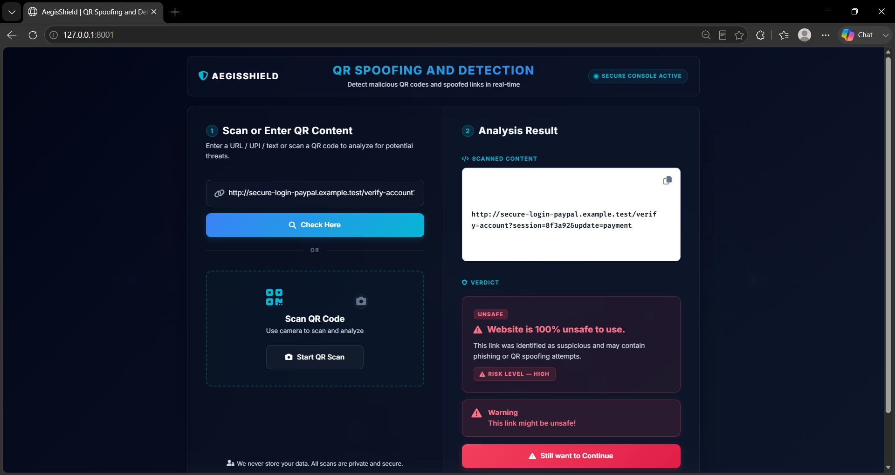
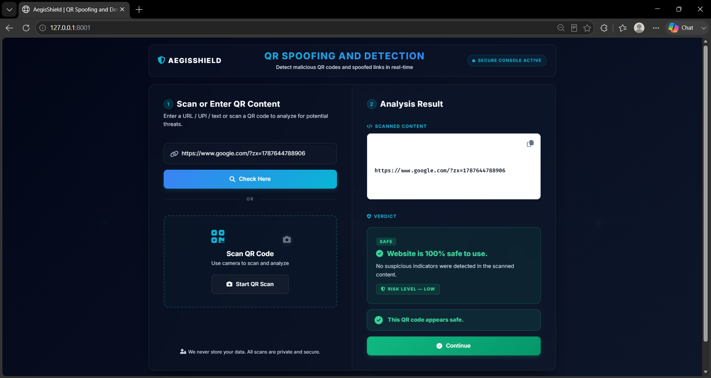

# 🛡️ AEGISSHIELD — QR Spoofing and Detection

> **Don't trust a QR code just because it looks legitimate. Verify what's behind it first.**

AEGISSHIELD is a **machine-learning-powered cybersecurity web application** designed to analyze URLs and QR-code payloads for potentially suspicious, phishing, or spoofed destinations.

The application allows users to **enter a URL manually or scan a QR code**, extract its underlying content, analyze the destination using a trained machine-learning model, and receive a clear **Safe / Unsafe security verdict with a risk level**.

---

## ✨ Overview

QR codes are convenient, but they can also hide malicious destinations.

An attacker can replace a legitimate QR code with a malicious one that redirects users to a phishing page, fake login portal, suspicious payment destination, or spoofed website.

AEGISSHIELD acts as a security checkpoint between **scanning a QR code and trusting its destination**.

### 🔄 Core Flow

```text
          QR Code / URL
                │
                ▼
       ┌──────────────────┐
       │ Content Extraction│
       └────────┬─────────┘
                │
                ▼
       ┌──────────────────┐
       │ URL Classification│
       └────────┬─────────┘
                │
                ▼
       ┌──────────────────┐
       │ Feature Extraction│
       └────────┬─────────┘
                │
                ▼
       ┌──────────────────┐
       │ Machine Learning  │
       │      Model        │
       └────────┬─────────┘
                │
          ┌─────┴─────┐
          ▼           ▼
       🟢 SAFE      🔴 UNSAFE
          │           │
          ▼           ▼
       Low Risk    High Risk
```

---

# 🚀 Key Features

### 🔗 URL Detection

Enter a URL manually and analyze it for suspicious characteristics associated with phishing and malicious websites.

### 📷 QR Code Scanning

Scan QR codes directly using the device camera.

The application automatically:

1. Detects the QR code.
2. Extracts its payload.
3. Determines the content type.
4. Analyzes URLs when applicable.
5. Displays the security verdict.

### 🤖 Machine Learning Detection

AEGISSHIELD uses a trained **Gradient Boosting Classifier** for URL classification.

The model analyzes multiple URL security characteristics rather than relying on a single rule.

### 🧩 URL Feature Analysis

The feature-extraction pipeline evaluates characteristics such as:

* IP address usage
* URL length
* URL shortening
* Suspicious symbols
* Redirect patterns
* Domain structure
* Subdomains
* HTTPS usage
* Domain registration information
* Non-standard ports
* External resource behavior
* Anchor URL behavior
* Other URL and webpage characteristics

### 🟢 Safe Detection

For URLs classified as safe, the application provides a clear green security state:

> **Website is 100% safe to use.**

along with:

> **Risk Level — LOW**

### 🔴 Unsafe Detection

For suspicious URLs, AEGISSHIELD displays a prominent warning state:

> **Website is 100% unsafe to use.**

along with:

> **Risk Level — HIGH**

The interface also warns users that the link may contain phishing or QR-spoofing attempts.

### 💳 UPI & Non-Web QR Handling

Not every QR code contains a website.

AEGISSHIELD can recognize QR payloads such as:

```text
upi://pay?pa=example@upi
```

and distinguish them from normal website URLs.

Plain-text QR content can also be handled separately rather than being incorrectly passed through the URL phishing classifier.

### 📋 Payload Inspection

The extracted QR content is displayed clearly in the analysis panel so users can see what is actually encoded inside the QR code.

A copy button is also provided for convenient payload inspection.

### 🔐 Privacy-Focused Design

The interface communicates a privacy-first approach:

> **We never store your data. All scans are private and secure.**

### 🎨 Cybersecurity SaaS Interface

AEGISSHIELD uses a modern security-console design featuring:

* Dark navy interface
* Cyan/blue security accents
* Green safe state
* Red unsafe state
* Glass-style cards
* Responsive layout
* Professional icons
* Clear risk indicators
* Security-focused visual hierarchy

---

# 🖥️ Application Screenshots

## 🏠 Main Dashboard

The AEGISSHIELD dashboard provides a simple workflow for entering or scanning QR content.



---

## 🟢 Safe QR Detection

When a QR code contains a URL classified as safe, the application displays a green verdict and low-risk indicator.



---

## 🔴 Unsafe QR Detection

When suspicious characteristics are detected, AEGISSHIELD displays a high-risk warning and clearly communicates that the destination may be unsafe.



---

## 🔗 URL Detection

Users can also directly enter a URL without scanning a QR code.



---

# 🧠 Machine Learning

The URL detection component uses a **Gradient Boosting Classifier** trained on phishing URL data.

### Machine Learning Pipeline

```text
Phishing URL Dataset
        │
        ▼
Data Preprocessing
        │
        ▼
Feature Extraction
        │
        ▼
Train / Test Split
        │
        ▼
Gradient Boosting Classifier
        │
        ▼
Model Evaluation
        │
        ▼
Saved Model
        │
        ▼
Flask Application
```

The trained model is loaded by the Flask backend and used for real-time prediction.

---

# 🔍 URL Feature Extraction

The application extracts a set of security-related features from URLs before sending them to the machine-learning model.

Examples include:

| Feature              | Purpose                                      |
| -------------------- | -------------------------------------------- |
| IP Address           | Detects URLs using raw IP addresses          |
| URL Length           | Identifies unusually long URLs               |
| URL Shortening       | Detects shortened URLs                       |
| `@` Symbol           | Identifies suspicious URL structures         |
| Redirecting          | Detects potential redirects                  |
| Domain Prefix/Suffix | Examines suspicious domain patterns          |
| Subdomains           | Measures domain complexity                   |
| HTTPS                | Checks secure protocol usage                 |
| Domain Registration  | Examines domain registration characteristics |
| Non-standard Port    | Detects unusual ports                        |
| Favicon              | Checks favicon-related behavior              |
| Request URL          | Analyzes external resource requests          |
| Anchor URL           | Examines anchor/link behavior                |

The feature vector used during prediction is kept consistent with the model's training pipeline.

---

# 🏗️ System Architecture

```text
┌───────────────────────────────────────────────┐
│                 AEGISSHIELD UI                │
│                                               │
│  URL Input  ─────────────┐                   │
│                          │                   │
│  QR Scanner ─────────────┤                   │
└──────────────────────────┼────────────────────┘
                           │
                           ▼
                  ┌─────────────────┐
                  │ Flask Backend   │
                  └────────┬────────┘
                           │
                           ▼
                  ┌─────────────────┐
                  │ Content Handler │
                  └────────┬────────┘
                           │
                 ┌─────────┴─────────┐
                 │                   │
                 ▼                   ▼
             Web URL            UPI / Text
                 │                   │
                 ▼                   ▼
        Feature Extraction      Informational
                 │                Handling
                 ▼
        30 URL Security Features
                 │
                 ▼
       Gradient Boosting Model
                 │
                 ▼
          Security Verdict
          /             \
         ▼               ▼
      🟢 SAFE          🔴 UNSAFE
         │               │
         ▼               ▼
      LOW RISK        HIGH RISK
```

---

# 🛠️ Technology Stack

## Backend

* **Python**
* **Flask**

## Machine Learning

* **Scikit-learn**
* **Gradient Boosting Classifier**
* **Pandas**
* **NumPy**
* **Pickle**

## URL Analysis

* Python URL parsing
* Requests
* BeautifulSoup
* WHOIS/domain information utilities

## QR Scanning

* **HTML5 QR Code / browser camera scanning**

## Frontend

* HTML5
* CSS3
* JavaScript
* Bootstrap
* Font Awesome

## Development

* Jupyter Notebook
* VS Code
* Git
* GitHub

---

# 📁 Project Structure

```text
AEGISSHIELD/
│
├── app.py
├── feature.py
├── phishing.csv
├── requirements.txt
├── Procfile
│
├── Phishing URL Detection.ipynb
│
├── pickle/
│   └── model.pkl
│
├── templates/
│   └── index.html
│
├── static/
│   ├── styles.css
│   └── ...
│
├── screenshots/
│   ├── home_page.png
│   ├── qr_safe_detection.png
│   ├── qr_unsafe_detection.png
│   └── url_detection.png
│
├── walkthrough.md
│
└── README.md
```

> Keep your virtual environment (`venv/` or `.venv/`) out of the GitHub repository.

---

# ⚙️ Installation

## 1. Clone the Repository

```bash
git clone <YOUR_GITHUB_REPOSITORY_URL>
cd AEGISSHIELD
```

## 2. Create a Virtual Environment

### Windows

```powershell
python -m venv venv
```

Activate it:

```powershell
venv\Scripts\activate
```

### macOS / Linux

```bash
python3 -m venv venv
source venv/bin/activate
```

## 3. Install Dependencies

```bash
pip install -r requirements.txt
```

---

# ▶️ Run the Application

From the project workspace directory:

```powershell
venv\Scripts\python app.py
```

Once Flask starts, open:

```text
http://127.0.0.1:8001
```

The exact address and port may also be displayed in the terminal when the application starts.

---

# 📷 Using the QR Scanner

1. Open the AEGISSHIELD dashboard.
2. Click **Start QR Scan**.
3. Allow camera access.
4. Point the camera at a QR code.
5. Wait for the QR payload to be detected.
6. AEGISSHIELD analyzes the extracted content.
7. Review the security verdict and risk level.

For browser camera access on a deployed application, HTTPS may be required.

---

# 🧪 Testing

AEGISSHIELD can be tested using different QR and URL categories.

### Safe Test

```text
https://example.com
```

Expected:

```text
🟢 SAFE
Risk Level — LOW
```

### Suspicious Test

Use a simulated suspicious URL such as:

```text
http://secure-login-paypal.example.test/verify-account
```

Expected:

```text
🔴 UNSAFE
Risk Level — HIGH
```

The `.test` domain is intended for testing and is not a real malicious website.

### UPI Test

```text
upi://pay?pa=test@example
```

This should be handled as a payment/UPI payload rather than as a normal website URL.

### Plain Text QR

```text
Hello from AEGISSHIELD
```

This should be treated as non-URL content.

---

# 📊 Model Evaluation

The original machine-learning experimentation compared multiple classification algorithms before selecting the best-performing approach.

The **Gradient Boosting Classifier** was selected for the URL detection component.

For reproducibility, evaluate the final retrained model using:

* Accuracy
* Precision
* Recall
* F1-score
* Confusion Matrix

### Important

Model performance metrics should always be reported on a **held-out test set**.

Do not interpret test-set accuracy as a guarantee of real-world phishing detection performance.

For the latest evaluation results, refer to the project's training notebook and `walkthrough.md`.

---

# 🔒 Security Considerations

AEGISSHIELD is designed as an additional security layer.

A **SAFE** classification does not guarantee that a website is completely harmless.

Likewise, an **UNSAFE** classification should be treated as a strong warning.

Users should never enter sensitive information such as:

* Passwords
* OTPs
* UPI PINs
* Banking credentials
* Credit/debit card information
* Authentication tokens

into websites they do not trust.

---

# ⚠️ Limitations

The detection system has several practical limitations:

* Machine-learning predictions depend on the training data.
* New phishing techniques may not match previously learned patterns.
* Some domain information may be unavailable.
* Network-dependent feature extraction may fail when a website blocks automated requests.
* A QR code containing a legitimate URL can still lead to harmful content if the website becomes compromised later.
* Detection results should therefore be treated as **security guidance rather than an absolute guarantee**.

---

# 🚀 Future Enhancements

Planned improvements can include:

* [ ] Real-time threat-intelligence integration
* [ ] Domain reputation analysis
* [ ] Google Safe Browsing integration
* [ ] VirusTotal integration
* [ ] URL redirect-chain analysis
* [ ] Advanced QR spoofing detection
* [ ] QR image upload
* [ ] Scan history
* [ ] Explainable AI predictions
* [ ] Detailed threat reports
* [ ] Browser extension
* [ ] Mobile application
* [ ] Advanced UPI fraud detection
* [ ] Multi-language support
* [ ] Improved real-time monitoring

---

# 📋 Technical Audit

A detailed technical audit and implementation walkthrough is available in:

```text
walkthrough.md
```

The audit covers the application's:

* Flask backend
* QR processing
* URL feature extraction
* Machine-learning pipeline
* Model integration
* Frontend/backend communication
* Detection logic
* Testing
* Potential limitations

---

# 🎯 Project Objective

The primary objective of AEGISSHIELD is to make QR-based interactions more transparent and safer by allowing users to **inspect the destination behind a QR code before interacting with it**.

Instead of:

```text
SCAN → TRUST
```

AEGISSHIELD encourages:

```text
SCAN → INSPECT → ANALYZE → VERIFY → PROCEED
```

---

# 💡 Why AEGISSHIELD?

QR codes hide their actual payload from users.

AEGISSHIELD exposes that payload and applies an additional layer of machine-learning-based security analysis.

> **See what's behind the QR before you trust it.**

---

# 👨‍💻 Project Information

**Project Name:** AEGISSHIELD

**Project Title:** QR Spoofing and Detection

**Domain:** Cybersecurity + Machine Learning

**Application Type:** Web Application

**Backend:** Flask

**Machine Learning:** Gradient Boosting Classifier

**Core Function:** QR payload and phishing URL analysis

---

# 📜 Disclaimer

AEGISSHIELD is developed for **educational, research, and cybersecurity-awareness purposes**.

The application provides predictions based on URL characteristics and the trained machine-learning model. It cannot guarantee that a website is completely safe or malicious.

Always exercise caution when scanning unknown QR codes or opening unfamiliar URLs.

---

## ⭐ AEGISSHIELD

**QR Spoofing and Detection**

> 🛡️ **Scan smart. Verify first. Stay protected.**
